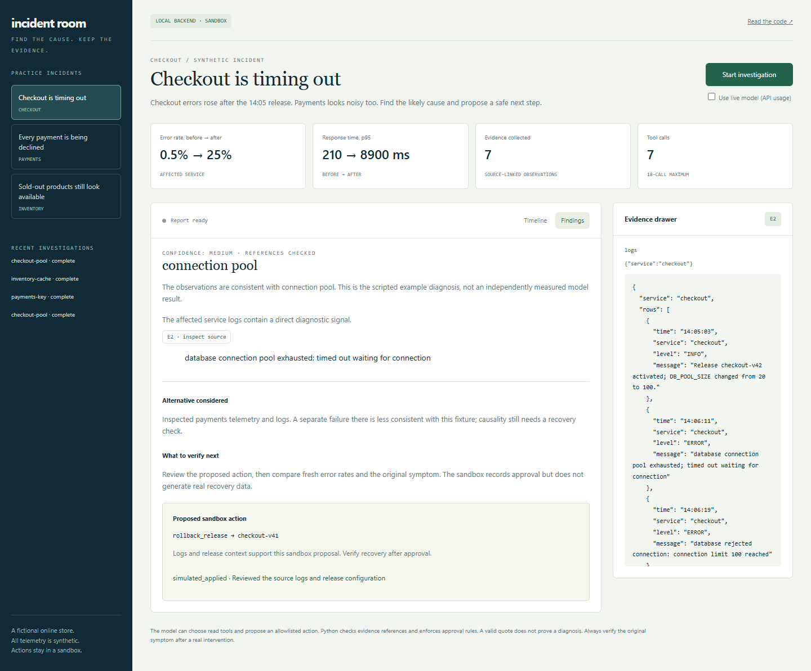
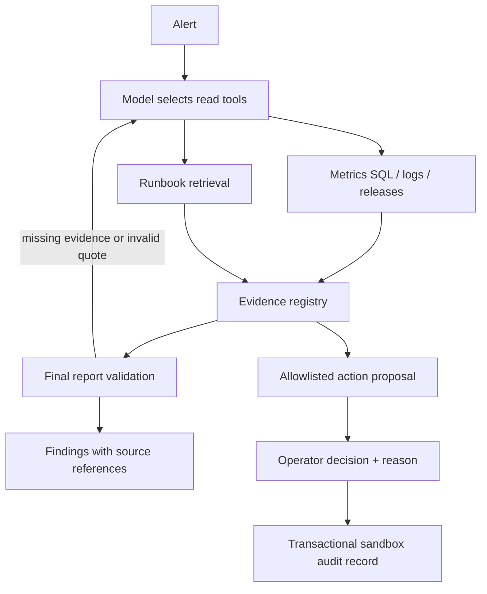

# Incident Room

[](https://github.com/charanneelam123-dot/incident-room/actions/workflows/checks.yml)

Checkout is timing out. Payments is noisy. A release went out five minutes ago.
What would you check first?

Incident Room lets a tool-using model investigate that question in a small,
fictional online store. It can query telemetry, inspect logs and releases, retrieve
runbooks, and propose a sandbox fix. Each finding has to point back to an actual
tool result. An operator decides whether to approve the proposal.

The local Python application includes the backend, a dashboard, SQLite history,
an approval audit log, and regression checks. The hosted demo replays the same
workflow without calling a model. It does not host the Python backend.



## Skills this project puts to work

| Area | Where it appears |
|---|---|
| Agentic AI | Model-selected tools, investigation state, validation feedback, bounded retries through the next turn |
| Generative AI | Structured diagnosis, evidence-linked findings, an alternative explanation, and a verification step |
| RAG | BM25 retrieval from local incident runbooks |
| Backend engineering | Parameterized SQL, SQLite persistence, a background investigation API, and resource limits |
| Human approval | Policy checks, a reason for each decision, concurrency protection, and a durable audit record |
| Evaluation | Repeatable incident cases, failure tests, and a separate live-evaluation command |

The [hosted replay](https://charan-incident-room.devi2026n.chatgpt.site) starts
private to the owner. Clone the repository to run the full backend locally.

## Run it

Python 3.11+ is enough. The runtime has no third-party dependencies.

```bash
git clone https://github.com/charanneelam123-dot/incident-room.git
cd incident-room
python -m incident_room serve
```

Open `http://127.0.0.1:8787`. Choose an incident and start an investigation. Inspect
the timeline or click a finding's evidence ID to see the original observation.
The dashboard keeps the proposed fix separate from the report. Approval requires
a reason and writes a sandbox decision record, never a real deployment.

Without a key, the backend runs an explicitly scripted workflow. To let a model
choose tools, set these variables before starting the server, then check **Use
live model** in the dashboard:

```powershell
$env:OPENAI_API_KEY = "your-key"
$env:OPENAI_MODEL = "your-model-id"
python -m incident_room serve
```

Choose a model with Chat Completions function calling support. See the
[API reference](https://developers.openai.com/api/reference/resources/chat) for
the request format. `.env` files are not automatically loaded. The key stays in
the backend process; it is never sent to the dashboard or recorded in a run.
Live mode sends synthetic alerts and tool observations to OpenAI and incurs usage.

## What it investigates

| Incident | Evidence to check | Sandbox proposal |
|---|---|---|
| Checkout timeouts | Connection count, pool exhaustion logs, per-replica pool change | Roll back checkout-v42 |
| Payment declines | Provider 401s, credential expiry, absence of a recent relevant release | Rotate a named test credential |
| Incorrect stock | Healthy HTTP latency, stale snapshot, flag disabling cache refresh | Disable inventory-cache-v2 |

The fixtures deliberately include distracting symptoms. Payments logs in the
checkout incident are downstream noise; low HTTP error rates in the stock
incident hide a consistency problem.

## The agent's workflow



Live mode chooses tool calls dynamically. The application requires telemetry,
logs, deployment context, a retrieved runbook, and a check of another service
before accepting the final report. A rejected report produces a validation
message the model can correct within its remaining turn budget.

Runbook retrieval uses BM25 over local Markdown sections. Telemetry queries use
parameterized SQLite reads; the model cannot supply arbitrary SQL. Each tool
result receives a run-scoped evidence ID. Final findings must cite a real
observation and include an exact quote from its JSON representation.

There is one agent with several tools. Splitting this into several named agents
would add coordination without much benefit for these small incidents.

## Approval and persistence

An action must match the scenario's explicit kind, service, and target allowlist.
It also needs nonempty log and release observations for the affected service.
The model can only queue a proposal. It has no shell, cloud credentials, payment
client, or production executor.

SQLite stores run events and decisions separately. Approval uses a transaction,
pending version check, and unique run/action key so two simultaneous approvals
cannot both succeed. Incomplete investigations cannot receive action decisions.
Restarting the app preserves completed runs and decisions.

The local server binds to loopback. Mutations require a startup-generated session
token and reject foreign origins; the token is separate from the model API key.
This is a local operator tool. It does not provide internet-facing authentication,
multi-user tenancy, or durable work queues.

## Budgets and failure behavior

- At most 10 model turns, four calls per turn, and 18 total tool calls.
- A 180-second investigation deadline and 30-second individual provider timeout.
- A 1,800-token output limit per request and a 20,000-token stop threshold based
  on provider-reported cumulative usage. The last request can exceed that threshold.
- No automatic paid retries. Provider failures leave partial observations visible.
- At most two active dashboard investigations. Runs in progress at process exit
  are not automatically resumed.

The application validates references, quote membership, and required observations.
It cannot establish that a diagnosis follows from a quote. A model can still
misinterpret correct evidence. This distinction matters more than a polished
confidence label.

## CLI and checks

```bash
python -m incident_room investigate checkout-pool --out reports/checkout.json
python -m incident_room investigate payments-key --live
python -m incident_room list
python -m incident_room evaluate
python -m unittest discover -s tests -v
```

Use `python -m incident_room decide RUN_ID action-1 approve --reason "Reviewed
the original logs"` to record a CLI decision. Add `--db PATH` before the command
to use another SQLite database.

The test suite covers policy bypasses, fabricated citations, report correction,
tool and token budgets, concurrent approvals, persistence, and the HTTP API.
GitHub Actions runs it across Python 3.11–3.14 and installs the package.

`evaluate` runs three regression scenarios. Default replay mode uses authored
diagnoses, so its pass rate only tests the workflow. `evaluate --live` calls the
configured model and reports completion, expected diagnosis terms, proposed
actions, token usage, and elapsed time. Those coarse checks are not a semantic
quality benchmark. No paid live evaluation has been run for this version.

## Demo and project notes

`python scripts/build_demo.py` rebuilds `dist/` from actual replay runs. The
hosted site shows those traces with a permanent scripted-demo label. Demo
approval is temporary browser state. The local dashboard uses the real Python
API and SQLite approval path.

The fixtures are small on purpose. Connecting real telemetry would require
read-only scoped credentials, time-window validation, secret redaction, and a
larger labeled incident set. The sandbox allowlist contains the expected action
for each example; it is not a learned remediation policy.

See [engineering notes](docs/engineering.md) for the data flow and gaps, and
[a short LinkedIn draft](docs/post-draft.md) for a project introduction.

MIT license.
